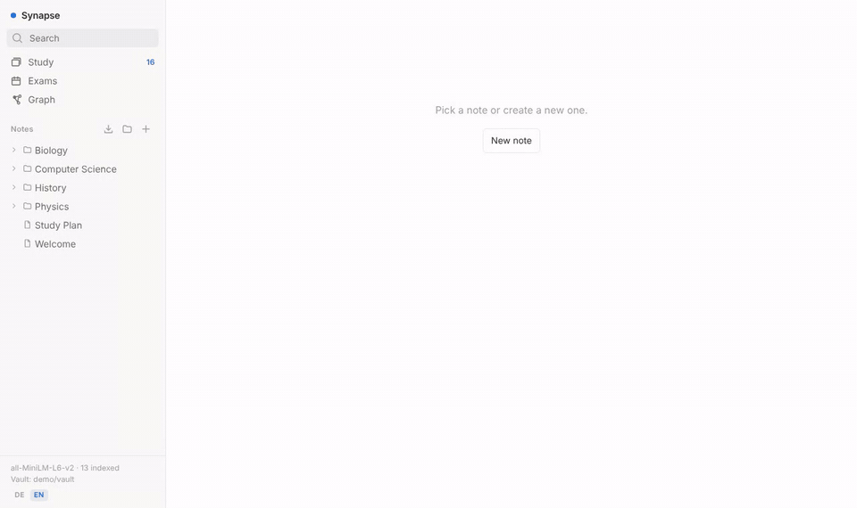
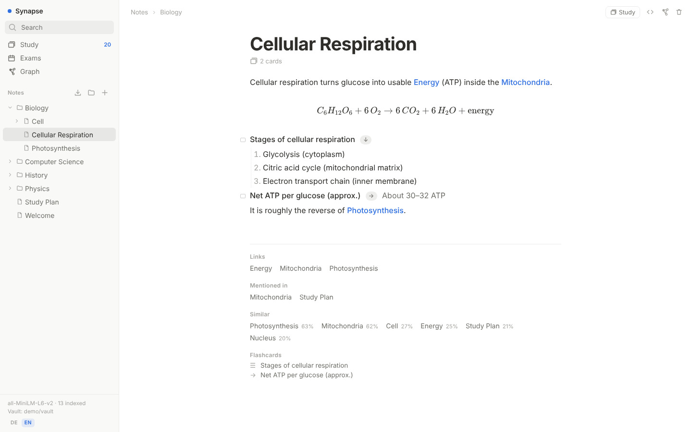
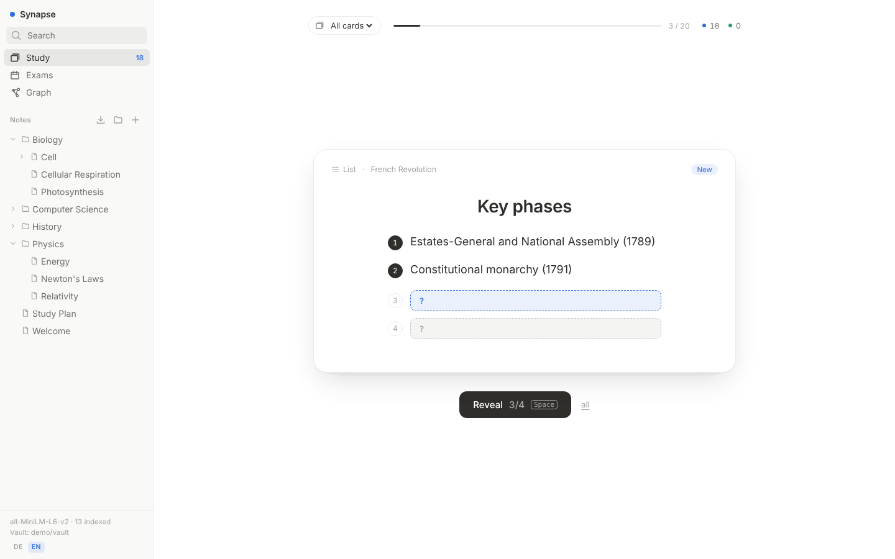
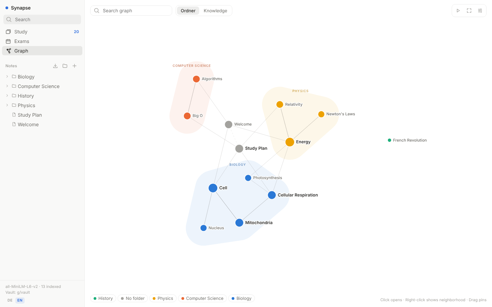
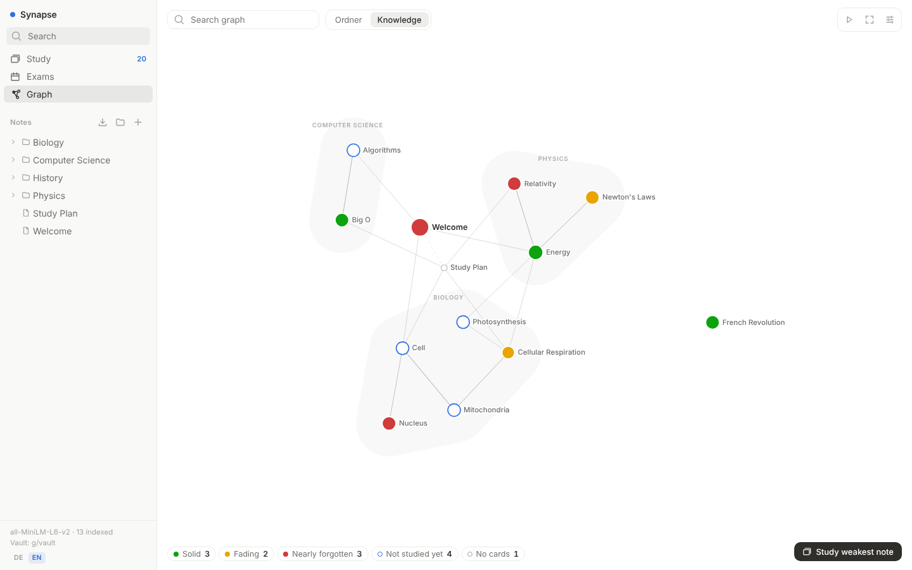

<div align="center">

# Synapse

**Notion + Anki + Obsidian in one app. Local-first, open source, plain Markdown.**

Write notes with a block editor, turn any line into a flashcard, study with spaced repetition,
and watch a knowledge graph connect related notes by itself, using a small AI model that runs on your machine.

[](https://github.com/moritzjh/Synapse/actions/workflows/ci.yml)
[](https://github.com/moritzjh/Synapse/pkgs/container/synapse)
[](LICENSE)

[Quick start](#quick-start) · [Features](#features) · [Comparison](#how-it-compares) · [AI / MCP](#ai-assistants-mcp) · [Deutsch](docs/README.de.md)



</div>

## Why Synapse?

Students and lifelong learners usually juggle three apps: **Notion** to write, **Anki** to memorize
and **Obsidian** to connect ideas. Synapse does all three in one place:

- **Your notes are the flashcards.** Type `Question >> Answer` in a note and it becomes a card. No copying into another app.
- **Links appear by themselves.** Every note is embedded by a local model, so notes about the same topic are connected in the graph even if you never linked them.
- **Your data stays yours.** Everything lives in a folder of Markdown files that Obsidian (or any editor) can open. No account, no cloud, no telemetry.
- **Fast.** The backend is C++ (SQLite, HNSW vector index, ONNX Runtime). Search and embedding take milliseconds.

## Quick start

You need [Docker](https://www.docker.com/products/docker-desktop/). Then run **one** of these:

```bash
# Docker Compose (recommended): data ends up in ./synapse/data
mkdir synapse && cd synapse
curl -fsSLO https://raw.githubusercontent.com/moritzjh/Synapse/main/docker-compose.yml
docker compose up -d
```

```bash
# or a single docker run
docker run -d --name synapse -p 127.0.0.1:8080:8080 -v ./synapse-data:/data --restart unless-stopped ghcr.io/moritzjh/synapse:latest
```

Open **http://localhost:8080**. The first start comes with a few demo notes so you can try everything right away
(set `SYNAPSE_DEMO=0` to start empty). Updating is `docker compose pull && docker compose up -d`.

<details>
<summary>Windows (PowerShell) without curl</summary>

```powershell
mkdir synapse; cd synapse
Invoke-WebRequest https://raw.githubusercontent.com/moritzjh/Synapse/main/docker-compose.yml -OutFile docker-compose.yml
docker compose up -d
```
</details>

<details>
<summary>Build from source instead</summary>

Requirements: CMake ≥ 3.20, a C++20 compiler, SQLite headers (`libsqlite3-dev` / `brew install sqlite`), Node.js ≥ 20.

```bash
git clone https://github.com/moritzjh/Synapse.git && cd Synapse
./scripts/setup_onnxruntime.sh                 # ONNX Runtime (Linux/macOS, x64/arm64)
./scripts/download_model.sh                    # multilingual-e5-small (or: minilm, English only)
cmake -S backend -B backend/build -G Ninja && cmake --build backend/build
(cd frontend && npm ci && npm run build)
cp -r demo/vault vault                         # optional demo notes
SYNAPSE_MODEL=models/multilingual-e5-small SYNAPSE_STATIC=frontend/dist ./backend/build/synapse synapse.db
```
For frontend development run `npm run dev` in `frontend/` (proxies `/api` to port 8080).
</details>

## Features

<table>
<tr>
<td width="50%"></td>
<td width="50%"></td>
</tr>
<tr>
<td></td>
<td></td>
</tr>
</table>

**Notes (Notion-style editor)**
- Block editor with a `/` menu, a `⋮⋮` drag handle and "Turn into" for every block, plus Markdown shortcuts (`#`, `-`, `1.`, `[]`, `>`, ` ``` `)
- Headings, lists, to-dos, toggles, callouts, quotes, tables, images (paste or drop), [Mermaid](https://mermaid.js.org) diagrams
- **LaTeX** with `$…$` and `$$…$$` (KaTeX), click a formula to edit it with a live preview
- Code blocks with syntax highlighting and automatic language detection; pasted code lands in a code block
- **Databases** like Notion: table, board (kanban) and chart views, properties (select, status, date, number…) and **formulas** (`if(prop("Done"), "✓", dateBetween(prop("Due"), now(), "days"))`)
- Folders, subfolders and subpages, folder pages, colours and emoji icons, clickable breadcrumbs
- `[[Wikilinks]]` with autocomplete, hover previews and backlinks. Mentions of other notes' titles are underlined with a one-click **"link it"** suggestion
- Every note is a `.md` file in the vault. Edit it in Obsidian or VS Code and Synapse picks it up. Raw Markdown mode built in

**Flashcards (RemNote-style)**, written right in your notes:

| You write | You get |
|---|---|
| `Question >> Answer` | a front → back card |
| `Term :: Definition` | two cards, both directions |
| `Question >>` + a list below | a list card: items are revealed **one by one** |
| `The {{mitochondria}} are the …` | a cloze card, gaps revealed one by one |
| an image + "Cover" + drag boxes | **image occlusion**, boxes revealed step by step |

- Scheduling with **FSRS-5** (the algorithm of modern Anki), keys `Space` and `1`–`4`
- **Exams:** set a date and the notes it covers. New cards are spread over the days left and weak cards are pulled before the exam, with a predicted retention on exam day
- Study everything, one exam, one folder or a single note, right from the sidebar
- **Import your Anki decks** (`.apkg` / `.colpkg`, old and new format): decks become notes, cloze, reversed cards, images and MathJax are kept

**Knowledge graph (Obsidian-style)**
- Drawn like a map: one softly shaded region per folder, labels beside the notes, local graph around a note, filters, groups, time-lapse
- **Knowledge view:** switch the colours from folders to *how well you know each note right now* (solid, fading, nearly forgotten, not studied yet), computed from your review history. One click studies the weakest note
- **Semantic edges:** a local embedding model ([multilingual-e5-small](https://huggingface.co/intfloat/multilingual-e5-small), 100+ languages) connects similar notes, with no API key and nothing leaving your machine
- "Similar notes" next to every note and search by meaning

**Yours**
- Local-first: one container or one binary, SQLite + a Markdown folder. Works offline
- English and German UI
- MIT licensed

## How it compares

| | Synapse | Notion | Obsidian | Anki | RemNote |
|---|:-:|:-:|:-:|:-:|:-:|
| Open source | ✅ MIT | ❌ | ❌ | ✅ AGPL | ❌ |
| Local-first, works offline | ✅ | ❌ | ✅ | ✅ | ⚠️ |
| Self-hosted, no account | ✅ | ❌ | ✅ | ✅ | ❌ |
| Notes are plain Markdown files | ✅ | ❌ | ✅ | ❌ | ❌ |
| Block editor (slash menu, drag & drop) | ✅ | ✅ | ⚠️ | ❌ | ✅ |
| Flashcards written inside notes | ✅ | ❌ | ⚠️ plugin | ❌ | ✅ |
| Spaced repetition (FSRS) | ✅ | ❌ | ⚠️ plugin | ✅ | ✅ |
| Image occlusion | ✅ | ❌ | ⚠️ plugin | ✅ | ✅ |
| Graph view | ✅ | ❌ | ✅ | ❌ | ⚠️ |
| Automatic links by meaning (local AI) | ✅ | ❌ | ⚠️ plugin | ❌ | ❌ |
| Built-in MCP server for AI assistants | ✅ | ✅ | ⚠️ plugin | ⚠️ add-on | ❌ |
| Free | ✅ | freemium | ✅ (sync paid) | ✅ (iOS paid) | freemium |

✅ built in · ⚠️ partly / via plugins · ❌ no. This is our best understanding; corrections are welcome via issue or PR.

Synapse is younger and smaller than all of these. There is no sync between devices, no mobile app and no
collaboration yet (see the [roadmap](#roadmap)). If you need those today, the apps above are great.

## AI assistants (MCP)

Synapse includes a [Model Context Protocol](https://modelcontextprotocol.io) server, so Claude, Cursor and
other assistants can read and write your notes, create flashcards, quiz you and manage exams.

```bash
# Claude Code
claude mcp add --transport http synapse http://127.0.0.1:8080/mcp
```

```json
// Claude Desktop (claude_desktop_config.json) – Docker install
{ "mcpServers": { "synapse": { "command": "docker", "args": ["exec", "-i", "synapse", "synapse", "mcp"] } } }
```

Tools: `list_notes`, `read_note`, `search_notes` (full-text + semantic), `create_note`, `update_note`, `delete_note`,
`list_tree`, `create_folder`, `move_note`, `get_databases`, `upsert_database_row`, `get_graph`, `list_cards`,
`review_queue`, `review_card`, `knowledge_status`, `list_exams`, `create_exam`, `update_exam`, `delete_exam`.

> *"Read my cell biology notes, write flashcards for everything important and create an exam for February 14th."*

## Configuration

| Variable | Default | Meaning |
|---|---|---|
| `PORT` | `8080` | HTTP port |
| `SYNAPSE_DB` | `synapse.db` | SQLite database |
| `SYNAPSE_VAULT` | `vault` | Markdown folder (open it in Obsidian) |
| `SYNAPSE_MODEL` | – | embedding model folder; without it there are no semantic links |
| `SYNAPSE_HOST` | `127.0.0.1` | bind address. There is **no login yet**, so keep it local or put an authenticating proxy in front |
| `SYNAPSE_ALLOWED_HOSTS` | – | extra host names the server answers to, e.g. `notes.example.com,192.168.1.20` (`*` = any). By default only `localhost` / `127.0.0.1`, which blocks other websites and DNS-rebinding from reaching your notes |
| `SYNAPSE_STATIC` | – | serve the built frontend |
| `SYNAPSE_DEMO` | `1` (Docker) | copy the demo notes on the very first start |

## Architecture

```
React 19 + TipTap ──HTTP/JSON──▶ C++20 backend (cpp-httplib)
                                 ├─ SQLite (WAL, FTS5): notes, links, cards, reviews, exams
                                 ├─ ONNX Runtime + own WordPiece/Unigram tokenizer → embeddings
                                 ├─ hnswlib HNSW index → similar notes / semantic edges
                                 ├─ FSRS-5 scheduler with exam deadlines
                                 ├─ Vault: two-way sync with Markdown files (md4c)
                                 └─ MCP server (Streamable HTTP + stdio bridge)
```

Indexing a typical note takes ~4 ms, embedding a long note (~1400 tokens) ~45 ms on a laptop CPU. Tokenizer
and embeddings are verified against the Hugging Face reference implementation.

## Roadmap

- [x] Notes, wikilinks, backlinks, full-text search, graph
- [x] Local embeddings + automatic semantic links
- [x] Flashcards in notes, FSRS, image occlusion, exams
- [x] Markdown vault (Obsidian compatible), MCP server
- [x] Databases with formulas, folders, LaTeX, Anki import
- [x] Knowledge view: the graph coloured by how well you know each note
- [ ] Desktop app with installer (Tauri)
- [ ] Mobile-friendly PWA for studying on the go
- [ ] Login + multi-user for server installs
- [ ] PDF import with highlights → cards
- [ ] Sync between devices

## Contributing

Issues, ideas and pull requests are very welcome, including bug reports with a sample note. For larger changes please open an
issue first. The CI builds and tests the backend (`backend/build/synapse_tests`) and lints/builds the frontend.

## License

[MIT](LICENSE). Bundled third-party code: [cpp-httplib](https://github.com/yhirose/cpp-httplib) (MIT),
[nlohmann/json](https://github.com/nlohmann/json) (MIT), [hnswlib](https://github.com/nmslib/hnswlib) (Apache-2.0),
[md4c](https://github.com/mity/md4c) (MIT). ONNX Runtime (MIT) and the embedding model (MIT) are downloaded at build time.
